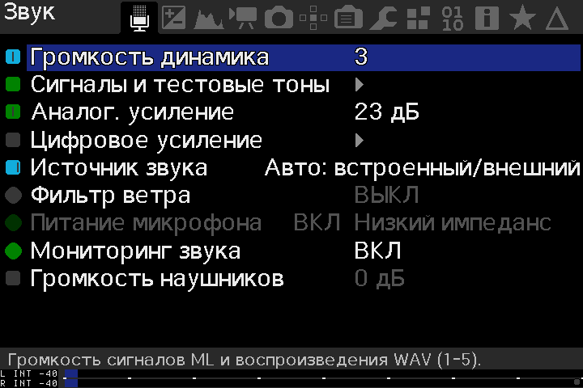
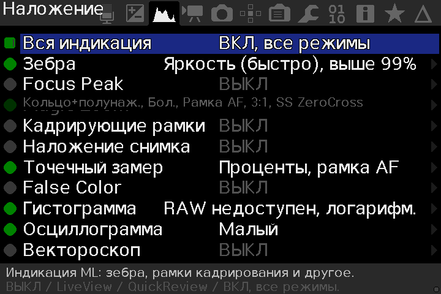
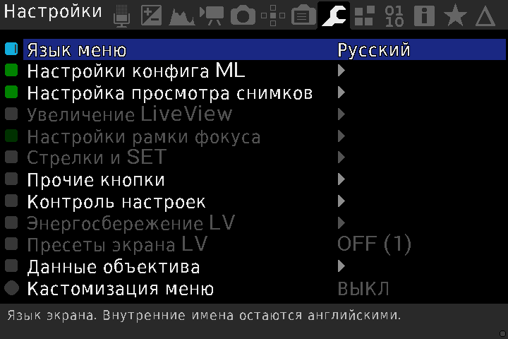
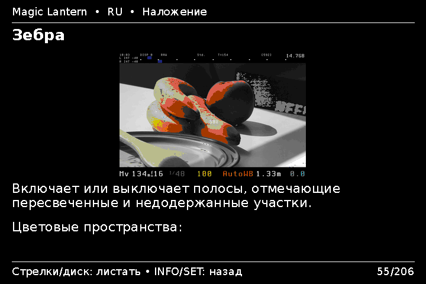

# Magic Lantern RU

Русификация Magic Lantern для Canon EOS 5D Mark II / Canon 2.1.2.

[Описание на русском](README-RU.md) · [Сборка](BUILD-RU.md)

Скриншоты меню

Скриншоты из эмулятора Canon EOS 5D Mark II.

**Звук**

**Наложение**

**Видео**

**Фокус**

**Настройки**

Скриншоты справки

Скриншоты из эмулятора Canon EOS 5D Mark II.

**Разделы полной справки**

**Оглавление**

**Зебра**

**Справка по интервалометру**

## Скачать

Только для **Canon EOS 5D Mark II с прошивкой Canon 2.1.2**.

- [Обновление поверх установленной ML](https://github.com/dimalishes/magiclantern_simplified_ru/releases/download/2026-10-28_5D2_ru.212/2026-10-28_5D2_ru.212_update.zip)
- [Чистая установка](https://github.com/dimalishes/magiclantern_simplified_ru/releases/download/2026-10-28_5D2_ru.212/2026-10-28_5D2_ru.212_clean_install.zip)
- [Все выпуски и инструкции](https://github.com/dimalishes/magiclantern_simplified_ru/releases)

База: `ed3e7c0dfacfdeaf3349dee73edf9e3621217462`. Лицензия и авторство Magic Lantern сохранены.
Другие модели с русификацией пока не проверялись.

---
Magic Lantern
=============

Magic Lantern (ML) is a software enhancement that offers increased
functionality to the excellent Canon DSLR cameras.
  
It's an open framework, licensed under GPL, for developing extensions to the
official firmware.

Magic Lantern is not a *hack*, or a modified firmware, **it is an
independent program that runs alongside Canon's own software**. 
Each time you start your camera, Magic Lantern is loaded from your memory
card. Our only modification was to enable the ability to run software
from the memory card.

ML is being developed by photo and video enthusiasts, adding
functionality such as: HDR images and video, timelapse, motion
detection, focus assist tools, manual audio controls much more.

For more details on Magic Lantern please see [http://www.magiclantern.fm/](http://www.magiclantern.fm/)

There is a sibling repo for our patched version of Qemu that adds support
for emulating camera ROMs. This allows testing without access to a physical
camera, and automating tests across a suite of cameras.  
https://github.com/reticulatedpines/qemu-eos  
https://github.com/reticulatedpines/qemu-eos/tree/qemu-eos-v4.2.1 (current ML team supported branch)
